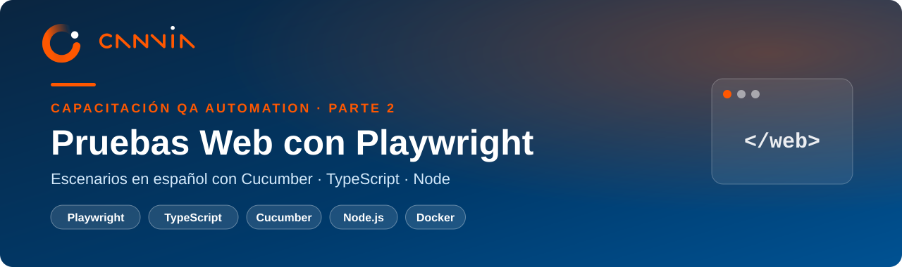
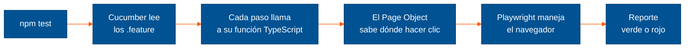
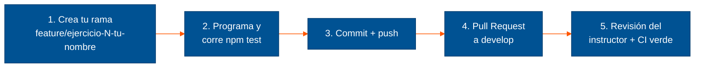

<div align="center">



<br/>

[](https://github.com/gpalominoh-canvia/canvia-playwright-bdd/actions/workflows/ci.yml)


**Capacitación QA Automation · Parte 2 de 2**<br/>
Aprende a probar páginas web automáticamente escribiendo los casos de prueba en español.

[Empezar](#empieza-aquí-elige-tu-camino) ·
[Ejecutar](#ejecutar-las-pruebas) ·
[Documentación](docs/README.md) ·
[Git y GitHub](docs/04-git-y-github.md)

</div>

---

## ¿Qué vas a aprender?

Probar una página web a mano es abrir el navegador, escribir usuario y clave, hacer clic y mirar si aparece
lo esperado. Hacerlo cien veces al día es lento y propenso a errores.

En este curso le enseñas a la computadora a hacerlo por ti: escribes **qué** debe pasar en español, y
**Playwright** abre el navegador, escribe, hace clic y comprueba el resultado, en segundos.

> **En una frase:** escribes el caso de prueba como lo contarías a un compañero, y un navegador robot lo ejecuta.

```gherkin
Escenario: Login exitoso
  Dado que estoy en la página de login
  Cuando ingreso con el usuario "standard_user" y la clave "secret_sauce"
  Entonces veo el catálogo de productos
```

Ese texto es una prueba real de este proyecto. Corre contra [SauceDemo](https://www.saucedemo.com),
una tienda en línea de práctica.

### Las piezas, explicadas como un robot

| Pieza | En el robot sería... | Qué hace aquí |
|---|---|---|
| **Node.js** | la batería | Ejecuta todo el código |
| **npm** | la tienda de repuestos | Descarga las librerías del `package.json` |
| **VS Code** | el taller | El editor donde escribes y ejecutas |
| **Playwright** | las manos y los ojos | Abre el navegador, escribe, hace clic y revisa la pantalla |
| **TypeScript** | el idioma del robot | El lenguaje en que se programa cada acción |
| **Cucumber** | las instrucciones | Convierte los escenarios en español en pasos ejecutables |

---

## Empieza aquí: elige tu camino

| Tu situación | Qué hacer | Tiempo |
|---|---|---|
| **Quiero dejar mi PC lista** (recomendado) | Sigue la [instalación en Windows, paso a paso](docs/01-instalacion-windows-paso-a-paso.md) | 20–30 min |
| **No pude instalar Node o Playwright** | Abre Docker Desktop y haz doble clic en **`iniciar-entorno.bat`** ([cómo funciona](docs/02-entorno-docker-alumnos.md)) | 10 min |
| **Nunca usé Git ni GitHub** | Lee [Git y GitHub desde cero](docs/04-git-y-github.md) | 20 min |
| **Soy el instructor** | Prepara la demo con [Windows en Docker](docs/03-windows-en-docker-instructor.md) | — |

¿Ya hiciste la parte 1 (REST Assured)? Ya tienes Git y VS Code: solo te falta Node.js.
¿Usas macOS o Linux? El [manual de instalación en PDF](docs/pdf/manual-instalacion-playwright-cucumber.pdf)
tiene una columna para cada sistema.

---

## Ejecutar las pruebas

Con tu PC lista, abre la terminal en la carpeta del proyecto. **La primera vez:**

```powershell
npm install                       # descarga las librerías
npx playwright install chromium   # descarga el navegador
```

**Cada vez que quieras probar:**

```powershell
npm test
```

**Lo que debes ver al final:**

```text
3 scenarios (3 passed)
15 steps (15 passed)
```

Si ves eso, todo funciona. El reporte con el detalle de cada escenario queda en `reports/cucumber-report.html`
(ábrelo con doble clic).

| Quiero... | Comando |
|---|---|
| Correr todo | `npm test` |
| Ver el navegador mientras prueba | `npm run test:headed` |
| Correr solo los escenarios marcados `@smoke` | `npm run test:smoke` |
| Revisar errores de TypeScript | `npm run typecheck` |
| Probar contra otra URL | `$env:BASE_URL="https://mi-ambiente"; npm test` |

### ¿Qué pasa cuando escribes `npm test`?



---

## ¿Qué hay en esta carpeta?

```text
canvia-playwright-bdd/
├── features/              ← los escenarios en español (.feature). Empieza leyendo aquí
├── src/
│   ├── steps/             ← el código detrás de cada frase del escenario
│   ├── pages/             ← Page Objects: dónde está cada botón y campo de una pantalla
│   └── support/           ← abre y cierra el navegador en cada escenario
├── package.json           ← la lista de librerías y los comandos npm
├── cucumber.js            ← configuración de Cucumber (idioma, reportes)
├── iniciar-entorno.bat    ← entorno listo en Docker (doble clic)
├── docker/windows/        ← Windows 11 en Docker para la demo del instructor
└── docs/                  ← guías y PDF del curso
```

---

## Documentación

| Guía | Para qué sirve |
|---|---|
| [1 · Instalación en Windows, paso a paso](docs/01-instalacion-windows-paso-a-paso.md) | Instalar Node, Git y VS Code, y ver las pruebas en verde |
| [2 · Entorno listo en Docker](docs/02-entorno-docker-alumnos.md) | Trabajar sin instalar nada (solo Docker Desktop) |
| [3 · Windows en Docker](docs/03-windows-en-docker-instructor.md) | Instructor: demo en vivo sobre un Windows limpio |
| [4 · Git y GitHub](docs/04-git-y-github.md) | Configurar Git, conectar tu cuenta y entregar ejercicios |
| [Manual de instalación (PDF)](docs/pdf/manual-instalacion-playwright-cucumber.pdf) | Versión completa para Windows, macOS y Linux |
| [Manual del entorno Docker (PDF)](docs/pdf/manual-entorno-docker-playwright.pdf) | Entorno del alumno y Windows en Docker, listo para imprimir |
| [Manual de Git y GitHub (PDF)](docs/pdf/manual-git-github.pdf) | La guía de Git en formato para imprimir |
| [Presentación del curso (PDF)](docs/pdf/presentacion-playwright-cucumber.pdf) | Láminas de clase y los 5 ejercicios |

---

## Cómo entregar un ejercicio



- **`develop`** es la rama de trabajo del curso; **`main`** guarda las versiones estables.
- Nadie sube directo a `develop` ni a `main`: todo entra por Pull Request, con la CI en verde y la aprobación del instructor.
- Los comandos exactos están en [Git y GitHub → El flujo de cada ejercicio](docs/04-git-y-github.md#6-el-flujo-de-cada-ejercicio).

---

## ¿Algo no funciona?

1. Revisa la tabla **"Si algo falla"** al final de la [instalación paso a paso](docs/01-instalacion-windows-paso-a-paso.md#si-algo-falla).
2. Si el problema es de Git (`403`, `Permission denied`), mira [errores frecuentes de Git](docs/04-git-y-github.md#8-errores-frecuentes).
3. Si sigues trabado, usa el [entorno listo en Docker](docs/02-entorno-docker-alumnos.md) para no perder la clase, y
   avísale al instructor con una captura del error.

<details>
<summary><strong>Versiones exactas del proyecto</strong></summary>

| Herramienta | Versión |
|---|---|
| Node.js | 22 o 24 (LTS) |
| Playwright | 1.64.1 |
| @cucumber/cucumber | 13.3.0 |
| TypeScript | 7.0.2 |
| tsx | 4.23 |

</details>

---

<div align="center">

<a href="https://canvia.com"></a>

**Capacitación QA Automation** · Parte 1: [APIs con REST Assured](https://github.com/gpalominoh-canvia/canvia-restassured-bdd) ·
Parte 2: Web con Playwright

<sub>Material de uso interno para la capacitación de Canvia.</sub>

</div>
